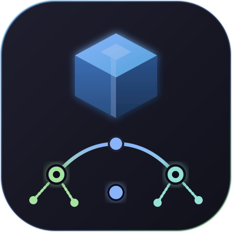
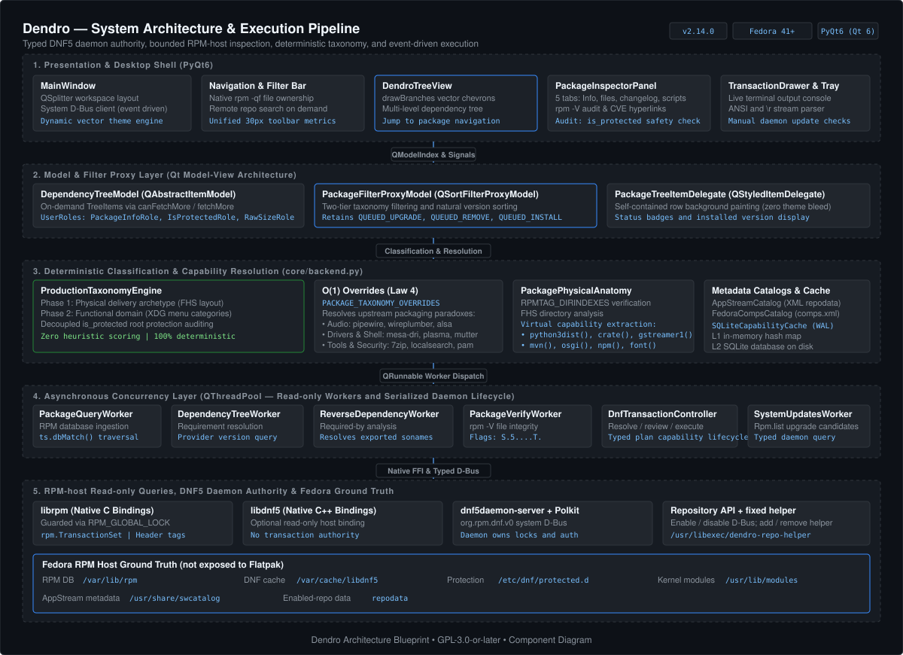
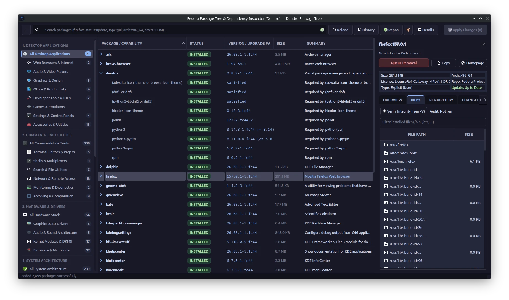
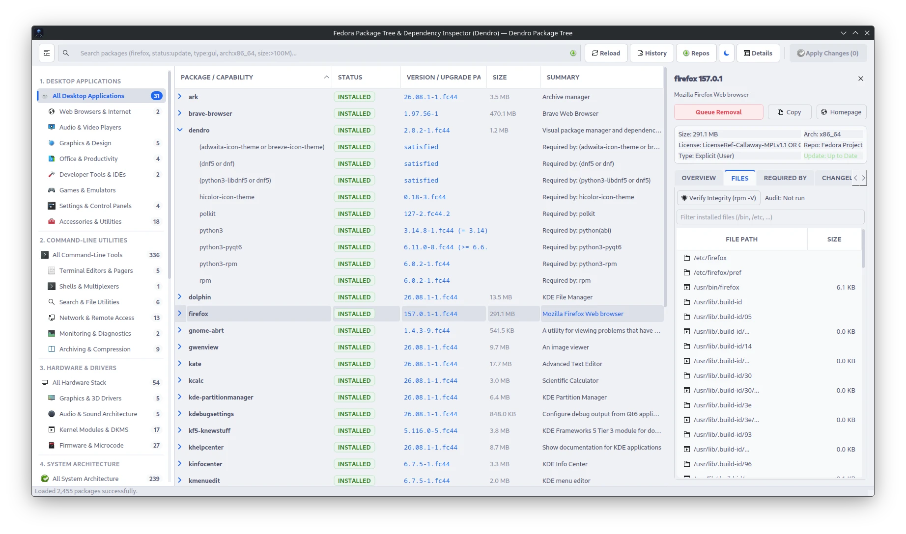

<div align="center">
<p align="center">
  
</p>

# Dendro

### Native Graphical Package Manager and Dependency Tree Explorer for Fedora Linux

[](https://getfedora.org)
[](https://copr.fedorainfracloud.org/coprs/xyasharx/dendro/)
[](https://github.com/xyasharx/Dendro/actions/workflows/ci.yml)
[](https://github.com/xyasharx/Dendro/releases/latest)
<br>
[](https://www.python.org/)
[](https://riverbankcomputing.com/software/pyqt/)
[](https://github.com/xyasharx/Dendro/releases)
[](https://www.gnu.org/licenses/gpl-3.0)

<p align="center">
  <a href="#key-features">Key Features</a> |
  <a href="#runtime-requirements">Runtime</a> |
  <a href="#taxonomy-model">Taxonomy Model</a> |
  <a href="#architecture">Architecture</a> |
  <a href="#installation">Installation</a> |
  <a href="#search-syntax">Search Syntax</a> |
  <a href="#keyboard-shortcuts">Shortcuts</a> |
  <a href="#running-tests">Testing</a> |
  <a href="#license">License</a>
</p>

---

</div>

**Dendro** is a graphical package manager and dependency hierarchy inspector for
Fedora Linux. It uses local `librpm` and optional `libdnf5` bindings for
read-only package inspection. Package changes, update checks, repository state,
and cache operations use Fedora's DNF5 system daemon on
`org.rpm.dnf.v0`. The daemon owns RPM transaction locking and Polkit
authorization; Dendro displays the resolved transaction plan before requesting
execution.

Dendro does not construct a generic privileged `dnf` command line for package
transactions.

---

## Key Features

- **Local RPM and libdnf5 inspection:** Reads installed RPM metadata and, when
  available, local DNF5 data through Fedora bindings. Native calls are guarded
  by `RPM_GLOBAL_LOCK`; unavailable optional bindings produce explicit reduced
  capability rather than an implicit failure.
- **DNF5 daemon-backed transactions:** Resolves install, remove, and upgrade
  requests through `dnf5daemon-server`, displays the daemon's structured plan,
  and executes only that retained plan after confirmation.
- **On-demand remote package search:** Searches enabled Fedora, RPM Fusion, and
  COPR repositories without loading every available package into the tree.
  Results can be reviewed and queued for a daemon-backed transaction.
- **File ownership lookup (`rpm -qf`):** Enter a path such as `/usr/bin/git` or
  `/usr/lib64/libc.so.6`, or use the `file:` prefix, to select its owning
  package.
- **Dependency navigation:** Double-click a dependency or an item in
  **Required By** to navigate to that package, including packages in another
  system pillar.
- **Two-phase taxonomy:** Separates physical package delivery form from
  functional domain classification across the package tree.
- **Protected-package warnings:** Reads `/etc/dnf/protected.d/` independently
  of taxonomy classification and highlights protected packages in removal
  plans.
- **Explicit taxonomy overrides:** Handles known multi-role package layouts
  through `PACKAGE_TAXONOMY_OVERRIDES` instead of scattered name checks.
- **Desktop launcher validation:** Uses RPM header directory indexes to
  distinguish desktop launchers under `/usr/share/applications/` from autostart
  entries and background services.
- **Virtual capability ingestion:** Uses RPM `Provides:` data for package
  ecosystems including `python3dist(...)`, `crate(...)`, `gstreamer1(...)`,
  `mvn(...)`, and `osgi(...)`.
- **Reverse dependency resolution:** Checks package capabilities and provided
  ELF sonames such as `libssl.so.3()(64bit)`, not only literal package names.
- **Maintainer scriptlet inspection:** Shows `%pre`, `%post`, `%preun`, and
  `%postun` scriptlets from RPM headers before installation.
- **Transaction-plan removal warnings:** Parses the daemon's resolved items and
  warns when a plan removes protected system packages.
- **Queued upgrades:** Retains staged upgrades across category filters and
  search queries until the transaction is resolved.
- **File integrity verification (`rpm -V`):** Shows digest, size, mode, and
  timestamp differences for files from a package manifest.
- **Local changelog inspection:** Reads RPM changelogs and links recognised CVE
  and Bugzilla references.
- **Capability cache:** Uses an in-memory cache with a persistent SQLite WAL
  cache at `~/.cache/dendro/capabilities_v5.db` for capability/provider lookup.
- **Catalog loading:** Streams AppStream XML while loading package metadata to
  limit retained XML memory.
- **Theme support:** Provides dark and light palettes with desktop portal
  detection where available.
- **Repository controls:** Enables, disables, lists, and cleans repositories
  through the DNF5 daemon. Deleting an eligible third-party `.repo` file is a
  separate constrained RPM-installed helper operation.
- **Repository origin validation:** Classifies Fedora, COPR, and RPM Fusion
  origins from parsed `baseurl` hostnames. A matching string in a URL path,
  query, user-info field, or lookalike hostname is not treated as an official
  origin.

---

## Runtime Requirements

Dendro supports Fedora installations with `dnf5daemon-server` version 5.2.7 or
newer. Package-changing features require:

- `dnf5daemon-server` and `dnf5daemon-server-polkit`;
- a working system D-Bus with an `org.rpm.dnf.v0` activation service;
- a desktop Polkit authentication agent for operations requiring authorization.

| Form | Package changes and updates | Local RPM inspection | Repository enable/disable | Repository-file deletion |
| --- | --- | --- | --- | --- |
| Fedora RPM installation | Supported through `org.rpm.dnf.v0` | Supported | Supported through `org.rpm.dnf.v0` | Supported by the installed helper |
| Source checkout, wheel, or AppImage on a Fedora host | Requires the host DNF5 daemon | Supported only on an RPM host | Requires the host DNF5 daemon | Not installed |
| Flatpak | Supported only when the host permits `org.rpm.dnf.v0` and Polkit authorizes the request | Not available | Supported only through `org.rpm.dnf.v0` | Not available |
| Desktop container without a system D-Bus and DNF5 daemon | Not supported | Limited to the container's own RPM state | Not supported | Not supported |

The Flatpak manifest grants only `--system-talk-name=org.rpm.dnf.v0`. It does
not use `flatpak-spawn --host`, a host filesystem mount, generic system-bus
access, or a generic Polkit action.

### Verify the DNF5 daemon

On a normal Fedora system, D-Bus can activate the daemon when Dendro first uses
it. Check the installed package and activation service with:

```bash
rpm -q dnf5daemon-server dnf5daemon-server-polkit
rpm -ql dnf5daemon-server | grep -F '/org.rpm.dnf.v0.service'
test -S /run/dbus/system_bus_socket && echo 'system D-Bus is available'
systemctl status --no-pager dnf5daemon-server.service
```

An inactive service is not necessarily an error before the first D-Bus request.
To diagnose the service directly on a booted Fedora system:

```bash
sudo systemctl start dnf5daemon-server.service
systemctl status --no-pager dnf5daemon-server.service
```

### Containers and Webtop

A desktop container can display Dendro without providing a usable package
management target. The container needs its own system D-Bus, DNF5 daemon
activation, Polkit policy, and lifecycle management; a graphical shell alone
is insufficient.

`lscr.io/linuxserver/webtop:fedora-kde` is not a supported environment for
Dendro package management. It is a desktop container, not a normally booted
Fedora installation. If Dendro reports:

```text
DNF5 daemon is unavailable: the name org.rpm.dnf.v0 was not provided by any .service files
```

the system D-Bus visible to Dendro cannot locate the DNF5 activation service.
Run these checks inside the container:

```bash
rpm -q dnf5daemon-server dnf5daemon-server-polkit
rpm -ql dnf5daemon-server 2>/dev/null | grep -F '/org.rpm.dnf.v0.service'
test -S /run/dbus/system_bus_socket && echo 'system D-Bus is available' || echo 'no system D-Bus socket'
ps -p 1 -o pid,comm,args=
systemctl status --no-pager dnf5daemon-server.service
```

Installing the daemon packages identifies a missing package contract but does
not turn a desktop container into a supported Fedora system:

```bash
sudo dnf install dnf5daemon-server dnf5daemon-server-polkit
```

Use a Fedora VM or installed Fedora desktop for repository and update testing
when PID 1 is not systemd or the system D-Bus is absent. Do not mount the host
D-Bus socket, host RPM database, or host filesystem into the container, and do
not use `--privileged` to bypass this boundary.

---

## Taxonomy Model

Package managers on Fedora face a structural classification challenge:

- **Fedora Packaging Baseline:** Fedora deprecated the RPM `Group:` tag in 2012
  (Fedora 17). Packages contain no canonical category tag in their RPM headers.
- **Comps Scope:** Distribution `comps.xml` metadata groups software primarily
  for operating system installation tasks (`@c-development`, `@gnome-desktop`),
  omitting standalone packages.
- **AppStream Scope:** FreeDesktop AppStream metadata targets end-user graphical
  applications, leaving libraries, system daemons, hardware drivers, and
  terminal utilities unrepresented.

### Two-Phase Classification Pipeline

Dendro separates the **Physical Archetype** (what a package installs) from the
**Functional Domain** (its operational role):

```text
[ RPM Package Manifest & Virtual Capabilities ]
                       │
                       ▼
┌─────────────────────────────────────────────────────────────┐
│ Phase 1: Physical Delivery Archetype (FHS Filesystem Audit) │
│ - O(1) Overrides    (PACKAGE_TAXONOMY_OVERRIDES map)        │
│ - Core System       (Base OS: glibc, systemd, dnf5, rpm)    │
│ - Hardware Driver   (/usr/lib/modules/, /usr/lib/firmware/) │
│ - Desktop App       (/usr/share/applications/ + DIRINDEXES) │
│ - System Daemon     (/usr/lib/systemd/ service units)       │
│ - Development SDK   (/usr/include/, *.pc files, -devel)     │
│ - GUI Toolkit       (/qt6/plugins, /gtk-3.0, toolkit libs)  │
│ - Media Codec       (/gstreamer-1.0, /vlc/plugins, codecs) │
│ - Language Runtime  (Python site-packages, Rust, JVM, Node) │
│ - CLI Utility       (/usr/bin/ command in PATH)             │
│ - Shared Library    (/usr/lib64/ ELF .so fallback)          │
│ - Static Assets     (Fonts, themes, icon sets, locales)     │
└──────────────────────────────┬──────────────────────────────┘
                               │
                               ▼
┌─────────────────────────────────────────────────────────────┐
│ Phase 2: Functional Domain (FreeDesktop XDG / POSIX Roles)  │
│ - Desktop Apps  --> XDG Main Categories                     │
│                     (Internet, Multimedia, Graphics, etc.)  │
│ - CLI Tools     --> POSIX Operational Roles                 │
│                     (Editors, Shells, Archiving, Net, etc.) │
│ - Runtimes      --> Virtual Capabilities & Ecosystems       │
│                     (python3dist, crate, mvn, npm, so)      │
└─────────────────────────────────────────────────────────────┘
```

Interactive desktop applications are identified through physical
`/usr/share/applications/` launcher manifests first, preventing media players
and visual tools from being misclassified into low-level driver or service
categories.

---

## Architecture

<div align="center">
  
</div>

Dendro moves blocking local queries and daemon work off the Qt event loop with
`QThreadPool`. Local RPM inspection stays separate from the DNF5 daemon client;
the transaction controller serializes daemon-backed package and repository
operations.

```text
dendro/
├── core/
│   ├── backend.py                # RPM/libdnf5 reads, taxonomy, and worker tasks
│   ├── dnf5daemon.py             # Typed org.rpm.dnf.v0 client and D-Bus transport
│   ├── models.py                 # DependencyTreeModel, filters, and tree nodes
│   ├── operation_gate.py         # Serialization of host-affecting operations
│   ├── repository_deletion.py    # Constrained repository-file helper lifecycle
│   └── transaction_controller.py # Daemon transaction lifecycle and cancellation
├── ui/
│   ├── delegates.py              # Tree rendering and status delegates
│   ├── header.py                 # Search, theme, update review, and action bar
│   ├── history_dialog.py         # DNF transaction history viewer
│   ├── inspector_panel.py        # Metadata, rpm -V, scriptlets, CVEs, and dependencies
│   ├── main_window.py            # Main controller, workers, tray, and dialogs
│   ├── repo_dialog.py            # DNF5 repository manager and cache controls
│   ├── settings_dialog.py        # Application settings
│   ├── sidebar.py                # Category navigation and counters
│   ├── styles.py                 # Palettes, QSS, and desktop portal integration
│   ├── transaction_drawer.py     # Daemon progress and authorization status
│   └── transaction_plan_dialog.py # Structured transaction-plan review
├── data/
│   ├── icons/                    # Vector and high-DPI raster application icons
│   ├── io.github.xyasharx.Dendro.desktop      # Desktop entry file
│   ├── io.github.xyasharx.Dendro.metainfo.xml # AppStream metadata
│   └── org.dendro.policy         # Polkit policy for the repository helper
├── tools/
│   └── dendro-repo-helper.py     # Constrained repository-file deletion helper
├── tests/                         # Unit and Qt tests
├── dendro.spec                    # Fedora RPM package definition
└── main.py                        # Application entry point
```

---

## Screenshots

<div align="center">
  

  <details>
    <summary><b>Click to view Light Theme Screenshot</b></summary>
    <br>
    
  </details>
</div>

---

## Installation

### Option 1: Native Fedora RPM via COPR (Recommended)

Enable the repository and install Dendro through DNF:

```bash
# Enable the repository
sudo dnf copr enable xyasharx/dendro -y

# Install Dendro and its Fedora runtime dependencies
sudo dnf install dendro -y

# Launch
dendro
```

The RPM declares `dnf5daemon-server`, `dnf5daemon-server-polkit`, and the
runtime dependencies required for daemon-backed package operations. It also
installs the constrained repository-file deletion helper and its Polkit policy.

---

### Option 2: Standalone AppImage

Download the latest AppImage from the [Releases](https://github.com/xyasharx/Dendro/releases) page:

```bash
chmod +x Dendro-x86_64.AppImage
./Dendro-x86_64.AppImage
```

The AppImage bundles the application runtime, not a Fedora package-management
service. Package changes, updates, and repository controls require the host's
DNF5 daemon and Polkit policy. It is not a portable package manager for
non-RPM distributions.

---

### Option 3: Run from Source

Use Fedora 41 or newer with Python 3.12 or newer:

```bash
# 1. Install Git and clone the repository
sudo dnf install -y git
git clone https://github.com/xyasharx/Dendro.git
cd Dendro

# 2. Install Fedora runtime dependencies
sudo dnf install -y \
  python3 \
  python3-pyqt6-base \
  python3-rpm \
  python3-libdnf5 \
  dnf5daemon-server \
  dnf5daemon-server-polkit \
  polkit \
  adwaita-icon-theme

# 3. Launch
python3 main.py
```

---

## Search Syntax

The search bar filters installed packages in real time, resolves file ownership
directly, and queries enabled DNF repositories on demand:

| Query Example | Description |
| :--- | :--- |
| `firefox` | Matches package names, summaries, and descriptions |
| `/usr/bin/git` or `file:/usr/lib64/libc.so.6` | Performs an RPM file-ownership lookup and selects the owning package |
| Pressing <kbd>Enter</kbd> (for example, `blender`) | Queries enabled repositories for uninstalled packages to review and install |
| `type:gui` or `type:cli` | Filters by interface form factor (Desktop App, CLI Tool, or Daemon) |
| `pillar:apps` or `pillar:hardware` | Filters by primary system pillar |
| `sub:desktop_internet` | Filters by granular subcategory key |
| `status:update` or `status:upgradable` | Shows installed packages with pending updates available |
| `status:user` or `status:manual` | Shows packages explicitly installed by the user |
| `status:orphan` | Displays unneeded leaf dependencies |
| `status:queued` | Shows packages staged for installation, removal, or upgrade |
| `arch:x86_64` or `arch:noarch` | Filters packages by target CPU architecture |
| `cat:graphics_drivers` or `cat:themes` | Filters packages by specific category identifier |
| `tag:python` or `tag:rust` | Filters packages by programming language ecosystem |
| `size:>100M` or `size:<50K` | Filters packages by installed disk size (`B`, `K`, `M`, `G`) |
| `repo:copr` | Filters packages installed from COPR repositories |
| `repo:fusion` | Filters packages from RPM Fusion channels |
| `license:gpl` or `license:mit` | Filters packages by software license identifier |

---

## Keyboard Shortcuts

| Shortcut | Action |
| :--- | :--- |
| <kbd>Ctrl</kbd> + <kbd>F</kbd> | Focus the search bar |
| <kbd>Ctrl</kbd> + <kbd>B</kbd> | Toggle / restore the category sidebar |
| <kbd>Ctrl</kbd> + <kbd>R</kbd> | Reload and re-index the system RPM database |
| <kbd>Ctrl</kbd> + <kbd>H</kbd> | Open DNF transaction history |
| <kbd>Ctrl</kbd> + <kbd>I</kbd> | Toggle Package Inspector side panel |
| <kbd>Enter</kbd> | Trigger an on-demand repository search for query text |
| <kbd>Space</kbd> | Toggle Install / Remove / Upgrade queue state for the selected package |
| Double-Click | Jump to a package definition from the dependency tree or Required By list |

---

## Running Tests

Install the development and test dependencies:

```bash
sudo dnf install -y \
  appstream \
  desktop-file-utils \
  flatpak-builder \
  python3-devel \
  python3-pip \
  python3-pyqt6-base \
  python3-pytest \
  python3-pytest-qt \
  python3-rpm \
  pyproject-rpm-macros \
  python3-setuptools \
  python3-wheel \
  rpm \
  rpm-build \
  ruff
```

Run the local checks used by CI:

```bash
export XDG_CONFIG_HOME="$(mktemp -d)"
export XDG_CACHE_HOME="$(mktemp -d)"
trap 'rm -rf "$XDG_CONFIG_HOME" "$XDG_CACHE_HOME"' EXIT

python3 -m compileall -q core ui tools main.py
ruff check core ui main.py tests tools --select=F,E9
QT_QPA_PLATFORM=offscreen PYTHONPATH=. python3 -m pytest -q tests
desktop-file-validate data/io.github.xyasharx.Dendro.desktop
appstreamcli validate --no-net data/io.github.xyasharx.Dendro.metainfo.xml
flatpak-builder --show-manifest io.github.xyasharx.Dendro.yml >/dev/null
```

The unit suite uses a fake typed D-Bus transport. It does not execute a real
RPM transaction. Test DNF5 daemon, Polkit, Flatpak permissions, and package
lifecycle on a configured Fedora host before release.

### Build an RPM

After committing the intended source tree, create the archive name expected by
`dendro.spec` and build it:

```bash
version="$(rpmspec -q --qf '%{VERSION}' dendro.spec)"
mkdir -p "$HOME/rpmbuild/SOURCES"
git archive --format=tar.gz --prefix="Dendro-${version}/" HEAD \
  > "$HOME/rpmbuild/SOURCES/dendro-${version}.tar.gz"
rpmbuild -ba dendro.spec
```

### Build the AppImage

The AppImage builder supports x86_64 only and verifies its pinned downloads
before use:

```bash
sudo dnf install -y appstream desktop-file-utils curl tar
bash build_appimage.sh
sha256sum Dendro-x86_64.AppImage
```

---

## Contributing

Bug reports, technical suggestions, and pull requests are welcome.

1. Fork the repository.
2. Create a branch (`git checkout -b feature/your-feature`).
3. Make the change and add or update tests where behavior changes.
4. Run the checks in [Running Tests](#running-tests).
5. Commit, push, and open a pull request.

---

## License

This project is licensed under the **GNU General Public License v3.0
(GPL-3.0-or-later)**. See the [LICENSE](LICENSE) file for details.
