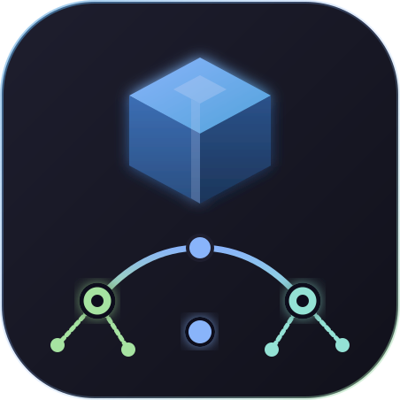
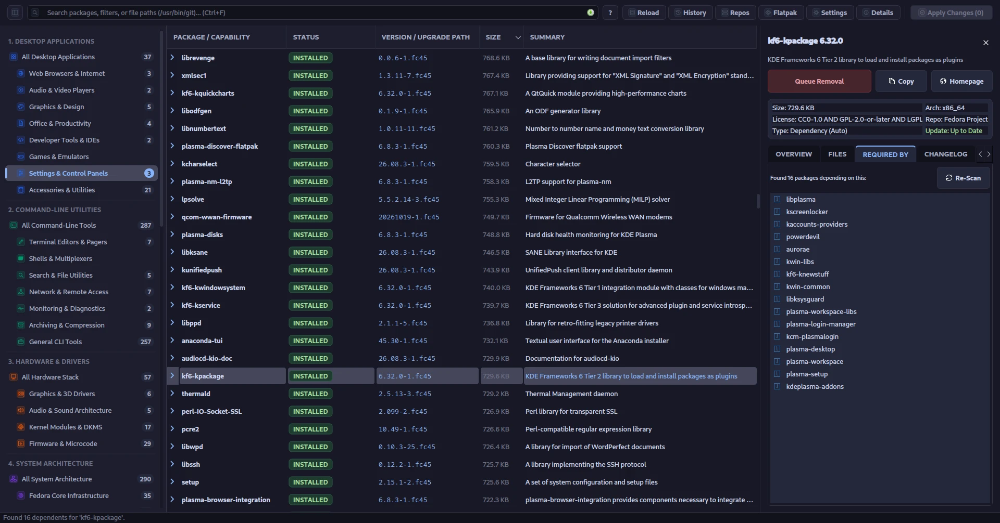
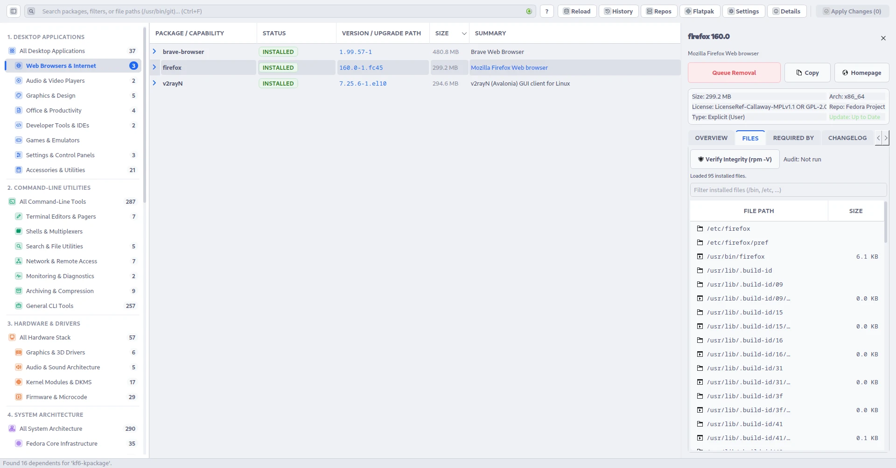
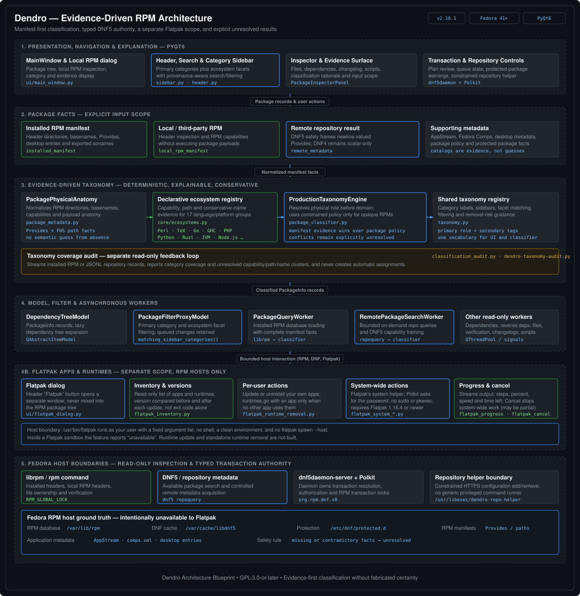

<div align="center">
<p align="center">
  
</p>

# Dendro

**Dendro is a graphical package manager for Fedora Linux** with a dependency
tree explorer: browse installed RPM packages, trace what requires what, and review
the full DNF5 transaction plan before anything changes.

[](https://getfedora.org)
[](https://copr.fedorainfracloud.org/coprs/xyasharx/dendro/)
[](https://github.com/xyasharx/Dendro/actions/workflows/ci.yml)
[](https://github.com/xyasharx/Dendro/releases/latest)
<br>
[](https://www.python.org/)
[](https://riverbankcomputing.com/software/pyqt/)
[](https://github.com/xyasharx/Dendro/releases)
[](https://www.gnu.org/licenses/gpl-3.0)

<p align="center">
  <a href="#installation">Install</a> &middot;
  <a href="#screenshots">Screenshots</a> &middot;
  <a href="#what-dendro-does">Features</a> &middot;
  <a href="#how-it-works">How it works</a> &middot;
  <a href="#search-syntax">Search</a> &middot;
  <a href="#how-dendro-compares-to-other-fedora-package-tools">Comparison</a> &middot;
  <a href="#frequently-asked-questions">FAQ</a> &middot;
  <a href="#development">Development</a>
</p>

</div>

Dendro is a package manager for Fedora, built for people who want to see what
they are changing before it happens. Browse everything installed on the system,
follow a dependency down to the library it actually needs, and review the
resolved transaction plan, including its download and disk-size impact, before
anything is applied.

It reads local RPM and DNF5 metadata for inspection, and performs package
changes through Fedora's own DNF5 system daemon on `org.rpm.dnf.v0`, so the
daemon keeps ownership of RPM locking and Polkit authorization. Dendro never
builds a privileged `dnf` command line to make a transaction happen.

Flatpak apps and runtimes are managed in a separate window and never mixed into
the RPM tree. See [Flatpak](#flatpak-apps-and-runtimes).

<div align="center">
  
</div>

---

## Installation

Dendro needs Fedora 43 or newer with `dnf5daemon-server` 5.2.7 or newer.

### COPR repository (recommended)

```bash
sudo dnf copr enable xyasharx/dendro -y
sudo dnf install dendro -y
dendro
```

The RPM pulls in `dnf5daemon-server`, `dnf5daemon-server-polkit`, and the rest
of the DNF5 runtime, and installs the constrained repository helper with its
Polkit policy (`org.dendro.policy`).

### Standalone AppImage

Download `Dendro-x86_64.AppImage` from the
[latest release](https://github.com/xyasharx/Dendro/releases/latest):

```bash
chmod +x Dendro-x86_64.AppImage
./Dendro-x86_64.AppImage
```

The AppImage bundles the application, not a package-management service. Package
changes still go through your host's DNF5 daemon, and adding or removing
repository files needs the RPM-installed helper, so that part is unavailable
here. It is not a portable package manager for non-RPM distributions.

### From source

```bash
sudo dnf install -y git python3 python3-defusedxml python3-pyqt6-base \
  python3-rpm python3-libdnf5 dnf5daemon-server dnf5daemon-server-polkit polkit
git clone https://github.com/xyasharx/Dendro.git
cd Dendro
python3 main.py
```

Dendro draws its own icons. A few menu and button icons come from your desktop's
icon theme and are omitted rather than replaced when the theme lacks them; on a
minimal desktop, install the fallback:

```bash
sudo dnf install -y adwaita-icon-theme
```

### Keep the daemon reachable

D-Bus activates the daemon on first use, so an inactive service before the first
request is normal. To confirm the package contract:

```bash
rpm -q dnf5daemon-server dnf5daemon-server-polkit
rpm -ql dnf5daemon-server | grep -F '/org.rpm.dnf.v0.service'
test -S /run/dbus/system_bus_socket && echo 'system D-Bus is available'
```

For a fuller check, see [Diagnosing the DNF5 daemon](#diagnosing-the-dnf5-daemon).

---

## Screenshots

<div align="center">
  
  <p><b>Dark mode</b> &mdash; browse the package tree, filter by category, and inspect any package's files, scriptlets, and reverse dependencies.</p>

  
  <p><b>Light mode</b> &mdash; the same session with the Files tab open, showing every installed file for a package.</p>
</div>

---

## What Dendro does

Fedora packages no longer carry a category tag, and no single metadata source
covers everything on a desktop. Dendro classifies packages from real evidence in
their manifests, and when the evidence is missing it says so instead of guessing.
That is what makes the sidebar trustworthy rather than decorative.

### Explore and inspect

- **RPM and DNF5 inspection** reads installed metadata locally, with optional
  libdnf5 data when the Fedora bindings are present. Native calls are guarded by
  `RPM_GLOBAL_LOCK`; missing optional bindings lower the feature set explicitly
  instead of failing quietly.
- **Dependency navigation** follows a dependency, or an entry in **Required By**,
  to that package, including packages in another part of the system.
- **Reverse dependency resolution** checks provided capabilities and ELF sonames
  such as `libssl.so.3()(64bit)`, not only literal package names.
- **File ownership lookup** resolves a path like `/usr/bin/git` or
  `/usr/lib64/libc.so.6`, or a `file:` prefix, to the package that owns it.
- **Maintainer scriptlets** shows `%pre`, `%post`, `%preun`, and `%postun` from
  the RPM header before you install anything.
- **File integrity check** (`rpm -V`) reports digest, size, mode, and timestamp
  differences for a package's files.
- **Changelog inspection** reads RPM changelogs and links recognised CVE and
  Bugzilla references.
- **Desktop launcher validation** uses RPM header directory indexes to tell a
  desktop launcher under `/usr/share/applications/` apart from an autostart
  entry or a background service.

### Change packages safely

- **Daemon-backed transactions** resolve install, remove, and upgrade requests
  through `dnf5daemon-server`, show the daemon's structured plan, and execute
  only that retained plan after you confirm it.
- **Plan sizes** shows the download size and the net change in installed size.
  Removals are subtracted, so the disk figure describes this system rather than
  the size of the download.
- **Protected-package warnings** reads `/etc/dnf/protected.d/` independently of
  classification and highlights protected packages in removal plans.
- **Security advisories** asks the daemon's `Advisory` interface which published
  advisories affect installed packages whose fix is not yet installed, and lists
  severity, title, affected NEVRA, and CVE or Bugzilla references.
- **Apply at next boot** can stage the reviewed plan instead of running it now:
  packages download immediately and apply from
  `dnf5-offline-transaction.service` before the desktop starts, which avoids
  changing libraries under a running session.
- **Queued upgrades** keep staged changes across category filters and searches
  until the transaction is resolved.
- **Repository key trust prompt** shows a repository's OpenPGP key fingerprint,
  signing identities, and download source, and offers to trust that one key,
  decline it, or stop asking for future repositories. Declining is the default.

### Find packages

- **On-demand remote search** queries enabled Fedora, RPM Fusion, and COPR
  repositories without loading every available package into the tree. Results
  can be reviewed and queued for a daemon-backed transaction.
- **Filter syntax** narrows the tree by architecture, status, category, evidence
  source, ecosystem, size, repository, or license. See
  [Search syntax](#search-syntax).

### Manage the system

- **Repositories** enables, disables, lists, and cleans repositories through the
  DNF5 daemon.
- **Add a repository file** downloads a direct HTTPS `.repo` configuration as
  your user, validates it, and adds one new signed third-party configuration
  through a constrained helper. This needs an RPM installation.
- **Repository origin validation** classifies Fedora, COPR, and RPM Fusion origins
  from parsed `baseurl` hostnames, so a matching string in a path, query,
  user-info field, or lookalike hostname is not treated as official.
- **Themes** follow the system, or can be set to light or dark, using desktop
  portal colour-scheme detection where available.
- **Languages** follow your desktop, or can be pinned in Preferences. Dendro
  ships Spanish, Brazilian and European Portuguese, French, German, Hindi, and
  Russian alongside English, and switches language without a restart.

### Flatpak, separately

- **Flatpak apps and runtimes** live in their own window, opened from the header.
  They are never mixed into the RPM tree, categories, or DNF transactions.

---

## How it works

Three ideas explain most of Dendro's behaviour: what it is allowed to change, how
it decides a package's category, and how it keeps the interface responsive.

### What Dendro will not change

Package changes require a writable Fedora system. Dendro classifies the runtime
environment from kernel and filesystem state (`/.flatpak-info`, container marker
files, `/proc/1/comm`, `/run/ostree-booted`, and `statvfs('/usr')`) rather than
from environment variables, and adjusts what it enables accordingly.

| Environment | Package changes | Local RPM inspection | Repositories |
| --- | --- | --- | --- |
| Fedora RPM installation (writable) | Through `org.rpm.dnf.v0` | Yes | Enable/disable through the daemon; file add/remove through the installed helper |
| Source checkout, wheel, or AppImage on writable Fedora | Needs the host DNF5 daemon | Only on an RPM host | Enable/disable needs the host daemon; file add/remove unavailable |
| Fedora Atomic or read-only `/usr` (any install form) | Disabled; the image owns `/usr` | Yes, including OSTree provenance and `rpm -V --nomtime` | Disabled, to prevent override drift |
| Unbooted container (`toolbx`, `distrobox`, Podman/Docker without systemd) | Disabled; refuses a forwarded host bus | The container's own RPM and DNF5 data | Disabled |

On Fedora Atomic desktops (Silverblue, Kinoite, Sway Atomic, Budgie Atomic,
COSMIC Atomic, IoT, CoreOS), running Dendro on the host enters **Fedora Atomic
Read-Only RPM Mode**: live transactions, update checks, repository overrides, and
the repository helper are disabled, even if a volatile `usroverlay` is active, so
`/usr` and `/etc` cannot drift from the immutable deployment. Browsing,
dependency trees, local `.rpm` inspection, `rpm -V --nomtime`, Comps data from
`/var/cache/rpm-ostree`, deployment and layered-package inspection through
`org.projectatomic.rpmostree1`, and full Flatpak management stay available.

The Flatpak manifest grants only `--system-talk-name=org.rpm.dnf.v0`. It does not
use `flatpak-spawn --host`, a host filesystem mount, generic system-bus access,
or a generic Polkit action.

### How packages are classified

Fedora deprecated the RPM `Group:` tag in 2012, Comps groups are aimed at
install-time selections, and AppStream covers graphical applications only. What
remains is libraries, daemons, drivers, and terminal tools with no category
anywhere in their metadata.

Dendro answers this in two phases. First it establishes the **physical delivery
archetype**, what the package actually installs, from its file manifest: a
desktop application is one that ships a launcher under `/usr/share/applications/`,
a kernel module ships under `/usr/lib/modules/`, and a package is only called a
C/C++ shared library when its metadata positively exposes a shared-object
capability. Then it assigns a **functional domain** from the archetype, using
XDG categories for desktop applications, POSIX operational roles for CLI tools,
and virtual capabilities for language runtimes.

```text
[ RPM manifest & virtual capabilities ]
                 |
                 v
  Phase 1: physical archetype (FHS filesystem audit)
    core system, hardware driver, desktop app, system daemon,
    development SDK, GUI toolkit, media codec, language runtime,
    CLI tool, shared library, static assets, system data,
    repository sources, needs classification
                 |
                 v
  Phase 2: functional domain (XDG / POSIX roles)
    desktop apps  ->  XDG main categories
    CLI tools     ->  POSIX operational roles
    runtimes      ->  virtual capabilities & ecosystems
```

Some packages barely reveal their role: entry-point RPMs like `git`,
directory-owning `*-filesystem` packages, and repository-release packages.
Dendro first looks for narrow evidence such as `/etc/yum.repos.d`,
`/usr/share/zoneinfo`, or X.Org font and driver directories, and only then a
reviewable fallback role policy keyed on an exact package identity or a
constrained well-known namespace. Known multi-role layouts are handled explicitly
in `PACKAGE_TAXONOMY_OVERRIDES`. It never assigns a category because a name ends
in `-data`, `-common`, or `-filesystem`.

When the evidence is not there, the package goes to **Needs Classification** and
the inspector shows what was available and why it was not enough. That is a
deliberate result, not a failure. The same registry drives the sidebar labels,
filters, badge counts, and category removal guidance, so those views cannot drift
apart when a category changes.

`core/ecosystems.py` is the single declarative registry for language and platform
evidence, distinguishing strong RPM capabilities and well-known runtime paths
from a conservative name fallback. Every verified ecosystem tag stays attached,
so a service or development package remains findable by ecosystem without
overwriting its primary role. If several manifest ecosystems conflict and no
package namespace resolves the role, the result stays **Needs Classification**
with an explanation rather than being decided by rule order.

Remote metadata often carries virtual capabilities but not installed paths,
desktop launchers, or AppStream facts, so installed, local-file, and remote
packages can be classified from different amounts of evidence. The DNF5 search
adapter frames newline-valued `Provides:` records safely; the legacy DNF4 adapter
stays scalar-only until an equally safe contract exists. A package seen through
different scopes can therefore land in a different category, and Dendro says so
rather than pretending the answer is uniform.

### How the interface stays responsive

Blocking local queries and daemon work run off the Qt event loop on
`QThreadPool`. Capability and provider lookups are cached in memory and in a
persistent SQLite WAL cache at `~/.cache/dendro/capabilities_v6.db`. Local RPM inspection is separate from the DNF5 daemon client, and
the transaction controller and host-operation gate serialize daemon-backed
operations with the constrained helper's lifecycle.

Flatpak is its own layer: workers run the fixed `/usr/bin/flatpak` command as
your user, with a clean environment and no shell, and parse standard output only.
Progress reaches the window through queued Qt signals. Every result carries its
request serial, so a superseded result is dropped rather than overwriting a
newer one.

<div align="center">
  
</div>

### Flatpak apps and runtimes

The **Flatpak** button opens a separate window. Flatpak packages never enter the
RPM tree, categories, or DNF transactions. The window uses `/usr/bin/flatpak`,
which Dendro does not require at install time:

```bash
sudo dnf install flatpak
```

- Lists installed apps and runtimes with version, branch, origin, size, and
  whether they are installed for your user or system-wide.
- Updates and uninstalls apps for either scope, comparing the version before and
  after so the result says what changed rather than only that Flatpak exited
  successfully. Uninstalling can also remove the app's data, and a runtime is
  offered for removal only when no other app needs it.
- Shows progress as steps with Flatpak's own percentage, speed, and time left.
  **Cancel** stops a system-wide change, which may leave it partly applied, so
  refresh afterwards.
- Cannot install new apps, update or remove runtimes on its own, change remotes,
  or change app permissions. Use `flatpak update` and
  `flatpak uninstall --unused` for runtimes.
- Inside a Flatpak sandbox it reports the feature as unavailable and never uses
  `flatpak-spawn --host`, `sudo`, or `pkexec`.

System-wide changes run through Flatpak's own helper, which raises the Polkit
prompt; Dendro never handles your password. Flatpak 1.16.4 or newer is required,
1.18.4 is recommended, and Dendro shows a notice on older versions. The Flatpak
packaging targets writable Fedora DNF5 hosts; for Fedora Atomic, use the AppImage.

### Adding a repository file

The Repositories dialog accepts a direct HTTPS URL to a `.repo` file. It does not
accept a COPR project name, a `dnf copr` command, a local path, or an arbitrary
command. The URL is fetched as your user, with a bounded response, UTF-8
requirement, and normalised line endings, before Polkit authorisation. The
installed helper then permits only a small repository-option allowlist, requires
HTTPS sources and package-signature verification, rejects duplicate IDs, and
creates one root-owned file under `/etc/yum.repos.d` atomically without
overwriting.

This is RPM-installation-only: a Flatpak, AppImage, or source checkout has no
installed helper and must not launch a host helper. After the helper reports
back, Dendro refreshes the daemon-backed repository list instead of assuming a
local file change altered daemon state.

### Build identity

`dendro --version` reports the release version with labelled Git commit and tree
IDs when available. Source checkouts read them from Git; wheel, RPM, Flatpak, and
AppImage builds stamp the same data at build time. A `dirty` marker means tracked
files changed after the reported commit. This identifies the source snapshot; it
does not certify the build environment or binary reproducibility.

### Diagnosing the DNF5 daemon

If Dendro reports:

```text
DNF5 daemon is unavailable: the name org.rpm.dnf.v0 was not provided by any .service files
```

the system bus visible to Dendro cannot locate the activation service. On a
booted Fedora system:

```bash
rpm -q dnf5daemon-server dnf5daemon-server-polkit
rpm -ql dnf5daemon-server 2>/dev/null | grep -F '/org.rpm.dnf.v0.service'
test -S /run/dbus/system_bus_socket && echo 'system D-Bus is available'
ps -p 1 -o pid,comm,args=
sudo systemctl start dnf5daemon-server.service
systemctl status --no-pager dnf5daemon-server.service
```

A desktop container is not a supported package-management target. It would need
its own system D-Bus, DNF5 activation, Polkit policy, and lifecycle; a graphical
shell is not enough. `lscr.io/linuxserver/webtop:fedora-kde`, for example, is a
desktop container rather than a booted Fedora installation. Installing the daemon
packages there identifies a missing contract but does not make it a supported
system. Use a Fedora VM or installed desktop for repository and update testing
when PID 1 is not systemd. Do not mount the host bus socket, RPM database, or
filesystem into the container, and do not use `--privileged` to bypass the
boundary.

---

## How Dendro compares to other Fedora package tools

Fedora ships several ways to manage packages. They are not alternatives to each
other so much as tools for different jobs, and most people end up with more than
one installed.

| | What it is good at | Where Dendro differs |
| :--- | :--- | :--- |
| **`dnf` (command line)** | Scripting, anything on a server, exact control | Dendro is a GUI over the same DNF5 daemon, not a replacement. The tree, filters and plan review are for when you want to *see* the effect of a command before running it. |
| **GNOME Software / KDE Discover** | Finding and installing end-user applications from a curated catalogue | Dendro works with the packages you already have: all of them, including libraries, daemons, development packages and RPM Fusion. Its categories come from evidence in the package manifests, not from an app-store listing. |
| **`dnfdragora`** | A traditional DNF package browser | Dendro shows dependency relationships as a tree, classifies packages by what they actually install, and reviews the resolved transaction plan with download and disk-size impact before applying it. |
| **`rpm -q --whatrequires` / `rpm -V`** | Precise answers on the command line | Dendro exposes file ownership, reverse dependencies and `rpm -V --nomtime` verification in the same window as the package, without a terminal. |
| **`rpm-ostree`** | Managing deployments on Fedora Atomic | Dendro reads OSTree deployment state, layered packages and overrides read-only, and deliberately refuses to mutate an immutable host. |

Dendro never builds a privileged `dnf` command line. Every package change goes
through `org.rpm.dnf.v0`, so the DNF5 daemon keeps ownership of RPM locking and
Polkit authorization — the same mechanism `dnf` uses.

---

## Search syntax

The search bar filters installed packages as you type, resolves file ownership
directly, and queries enabled repositories on demand. Combine filters with
whitespace, for example `arch:noarch status:available`; every filter must match.

| Query | Description |
| :--- | :--- |
| `firefox` | Matches package names, summaries, and descriptions |
| `/usr/bin/git` or `file:/usr/lib64/libc.so.6` | RPM file-ownership lookup; selects the owning package |
| <kbd>Enter</kbd> on `blender` | Searches enabled repositories for uninstalled packages to review and install |
| `type:gui`, `type:cli` | Interface form factor: desktop app, CLI tool, or daemon |
| `pillar:apps`, `pillar:hardware` | Primary system pillar |
| `sub:desktop_internet` | Granular subcategory key |
| `status:update`, `status:upgradable` | Installed packages with pending updates |
| `status:user`, `status:manual` | Explicitly installed packages, including layered or overridden ones on Fedora Atomic |
| `status:layered`, `status:override`, `status:base` | OSTree deployment provenance on Fedora Atomic hosts |
| `status:orphan` | Unneeded leaf dependencies |
| `status:queued` | Packages staged for installation, removal, or upgrade |
| `arch:x86_64`, `arch:noarch` | Target CPU architecture |
| `cat:graphics_drivers`, `cat:cli_general`, `cat:unclassified` | The same registered category rule the sidebar uses |
| `evidence:appstream`, `evidence:insufficient_metadata` | Strongest classification evidence source |
| `scope:remote_metadata`, `scope:installed_manifest` | Facts available during classification |
| `tag:python`, `tag:rust` | Programming language ecosystem |
| `size:>100M`, `size:<50K` | Installed disk size in `B`, `K`, `M`, or `G` |
| `repo:copr`, `repo:fusion` | Installed from COPR or RPM Fusion |
| `license:gpl`, `license:mit` | Software license identifier |

---

## Keyboard shortcuts

| Shortcut | Action |
| :--- | :--- |
| <kbd>Ctrl</kbd> + <kbd>F</kbd> | Focus the search bar |
| <kbd>Ctrl</kbd> + <kbd>B</kbd> | Toggle or restore the category sidebar |
| <kbd>Ctrl</kbd> + <kbd>R</kbd> | Reload and re-index the system RPM database |
| <kbd>Ctrl</kbd> + <kbd>H</kbd> | Open DNF transaction history |
| <kbd>Ctrl</kbd> + <kbd>I</kbd> | Toggle the package inspector panel |
| <kbd>Enter</kbd> | Search enabled repositories for the query text |
| <kbd>Space</kbd> | Queue or unqueue install, remove, or upgrade for the selected package |
| Double-click | Jump to a package from the dependency tree or **Required By** list |

---

## Development

Fedora 43, 44, and 45 ship everything below except Bandit, which is test-only:

```bash
sudo dnf install -y appstream desktop-file-utils flatpak-builder \
  python3-defusedxml python3-devel python3-pip python3-pyqt6-base \
  python3-pytest python3-pytest-qt python3-rpm pyproject-rpm-macros \
  python3-setuptools python3-wheel rpm rpm-build ruff

python3 -m venv --system-site-packages .dendro-ci-venv
.dendro-ci-venv/bin/python -m pip install "bandit>=1.7"
```

### Running the checks CI runs

```bash
export XDG_CONFIG_HOME="$(mktemp -d)"
export XDG_CACHE_HOME="$(mktemp -d)"
trap 'rm -rf "$XDG_CONFIG_HOME" "$XDG_CACHE_HOME"' EXIT

python3 -m compileall -q core ui tools main.py
ruff check core ui main.py tests tools --select=F,E9
ruff check --select=E,F,I,UP,B,SIM,PERF,RUF --ignore=E501 \
  core/taxonomy.py core/package_metadata.py core/package_classifier.py \
  core/ecosystems.py core/classification_audit.py tools/dendro-taxonomy-audit.py \
  tests/test_taxonomy_registry.py tests/test_package_metadata_parsers.py \
  tests/test_ecosystem_registry.py tests/test_classification_audit.py
ruff format --check \
  main.py core/backend.py core/models.py core/taxonomy.py \
  core/package_metadata.py core/package_classifier.py core/ecosystems.py \
  core/classification_audit.py tools/dendro-taxonomy-audit.py \
  ui/header.py ui/inspector_panel.py ui/main_window.py ui/sidebar.py \
  tests/test_entrypoint.py tests/test_taxonomy_registry.py \
  tests/test_package_metadata_parsers.py tests/test_ecosystem_registry.py \
  tests/test_classification_audit.py
.dendro-ci-venv/bin/python -m bandit -q -r \
  core/taxonomy.py core/package_metadata.py core/package_classifier.py \
  core/ecosystems.py core/classification_audit.py -lll
QT_QPA_PLATFORM=offscreen PYTHONPATH=. python3 -m pytest -q tests
desktop-file-validate data/io.github.xyasharx.Dendro.desktop
appstreamcli validate --no-net data/io.github.xyasharx.Dendro.metainfo.xml
flatpak-builder --show-manifest io.github.xyasharx.Dendro.yml >/dev/null
```

The unit suite uses a fake typed D-Bus transport and does not execute a real RPM
transaction. The Flatpak tests use fake command runners and a fixed binary check,
so they run without Flatpak installed. Before a release, exercise the daemon,
Polkit, and Flatpak lifecycle on a configured Fedora host, including a refused
Polkit prompt from a non-administrator account.

### Auditing taxonomy coverage

On a Fedora RPM host, generate a reproducible summary of the installed corpus
before changing taxonomy rules:

```bash
python3 tools/dendro-taxonomy-audit.py \
  --installed-rpm-database \
  --with-system-catalogs \
  --output taxonomy-audit.json
```

The audit reads RPM metadata only and never runs package payloads. Its
unresolved clusters are an evidence-discovery aid, not automatic category
assignments. Saved JSONL corpora can be audited with `--input corpus.jsonl`.

### Translating Dendro

Every user-facing string is written in English in the code and looked up in a
JSON catalog under `data/locales/`. Adding or fixing a translation needs no
build tools, no Qt linguist, and no extraction step:

```bash
# Show every string that needs a translation.
python3 tools/dendro-i18n.py list

# Check that each catalog still covers the code. Non-zero exit means drift.
python3 tools/dendro-i18n.py check

# Per-language coverage summary.
python3 tools/dendro-i18n.py stats
```

A catalog maps the English source text to the translation, so a translator can
see exactly which string they are changing:

```json
{
  "locale": "pt_BR",
  "plural_boundary": 2,
  "messages": {
    "System Up to Date": "Sistema atualizado"
  }
}
```

Shipped languages are English, Spanish, Brazilian Portuguese, European
Portuguese, French, German, Hindi, and Russian. Brazilian and European
Portuguese are separate catalogs rather than one shared file, because they
differ in ordinary vocabulary (`arquivo`/`ficheiro`, `tela`/`ecrã`,
`usuário`/`utilizador`), in how the progressive is formed, and in which
preposition a verb takes. To add a language, create
`data/locales/<locale>.json` with full coverage, register the locale in
`core/i18n.py`, and add the file to `[tool.setuptools.data-files]` in
`pyproject.toml` so packaged builds ship it. `tests/test_i18n.py` fails if a
catalog drifts behind the code, repeats the English text, ships an empty value,
leaves German transliterated as `ae`/`oe`/`ue`, drops the opening `¿` from a
Spanish question, or stops writing Russian and Hindi in their own scripts.

Accuracy is part of the work, not a finishing touch. A translation that reads
like English with the words swapped is a defect: plurals follow each language's
own rule, quoted interface text uses `« »` in Russian and the local convention
elsewhere, and terminology stays consistent — *package*, *repository*,
*transaction*, and *daemon* are never alternated with synonyms in the same
catalog. `python3 tools/dendro-i18n.py check` proves the catalogs match the
code; only a screenshot proves the window is actually translated, so run one in
a non-English locale before calling a translation done.

### Building packages

```bash
# RPM: archive the tree using the name dendro.spec expects
version="$(rpmspec -q --qf '%{VERSION}' dendro.spec)"
mkdir -p "$HOME/rpmbuild/SOURCES"
git archive --format=tar.gz --prefix="Dendro-${version}/" HEAD \
  > "$HOME/rpmbuild/SOURCES/dendro-${version}.tar.gz"
rpmbuild -ba dendro.spec

# AppImage: x86_64 only, verifies its pinned downloads before use
sudo dnf install -y appstream desktop-file-utils curl tar
bash build_appimage.sh
sha256sum Dendro-x86_64.AppImage
```

### Repository layout

```text
core/     RPM and DNF5 reads, daemon client, classification, transactions
ui/       Main window, header, sidebar, inspector, dialogs, styling
data/     Desktop entry, AppStream metadata, Polkit policy, icons, screenshots
tools/    Repository helper, taxonomy audit, release-tag verification
tests/    Unit and headless Qt tests
```

The larger modules are `core/backend.py` (RPM and libdnf5 reads, worker tasks),
`core/package_classifier.py` (evidence-aware taxonomy and removal guidance),
`core/ecosystems.py` (the declarative ecosystem registry),
`core/dnf5daemon.py` (typed `org.rpm.dnf.v0` client),
`ui/inspector_panel.py` (metadata, integrity, scriptlets, CVEs, dependencies), and
`ui/main_window.py` (controller, workers, and dialogs).

---

## Frequently asked questions

### Is Dendro a replacement for `dnf`?

No. Dendro is a graphical front end to the same Fedora DNF5 system daemon that
`dnf` talks to, and it is meant for the times you want to see the effect of a
change before making it. For scripting and remote servers, use `dnf`.

### Does Dendro run as root?

Never. The Daemon, not Dendro, holds the RPM lock and asks Polkit for
authorization. Dendro has no setuid component, never reads or stores your
password, and never constructs a privileged `dnf` command line.

### Does it work on Fedora Silverblue, Kinoite, or other Atomic desktops?

Yes, in a deliberately limited mode. On Fedora Atomic or any host with a
read-only `/usr`, package changes are disabled because the image owns `/usr`.
Browsing, dependency trees, local `.rpm` inspection, `rpm -V --nomtime`,
deployment and layered-package inspection, and full Flatpak management still
work.

### Do I need `dnf5daemon-server`?

Yes. Package changes go through the DNF5 daemon on `org.rpm.dnf.v0`, which is
what keeps Polkit authorization and RPM locking in Fedora's own code rather than
in a GUI running as your user. `sudo dnf install dnf5daemon-server` if it is
missing.

### Can Dendro manage Flatpak applications?

Yes, in a separate window, and Flatpak apps are never mixed into the RPM
dependency tree. System-wide Flatpak operations are authorized by Flatpak's own
Polkit helper.

### Which languages does the interface support?

English is the source language. Dendro also ships Spanish, Brazilian Portuguese,
European Portuguese, French, German, Hindi, and Russian, and can switch language
without restarting the application.

### How is Dendro installed?

The recommended route is the [COPR repository](#copr-repository-recommended),
which keeps Dendro updated through `dnf`. A standalone AppImage is available from
the [releases page](https://github.com/xyasharx/Dendro/releases), and Dendro can
be run from source.

### How are packages categorised without category metadata?

Fedora packages no longer carry a category tag, so Dendro classifies them from
evidence in their manifests — where files are installed, what ELF objects they
export, and which language ecosystems they belong to. When the evidence is
missing it says `Needs Classification` and shows why, instead of guessing.

---

## Contributing

Bug reports, technical suggestions, and pull requests are welcome.

1. Fork the repository.
2. Create a branch: `git checkout -b feature/your-feature`.
3. Make the change and add or update tests where behaviour changes.
4. Run the checks in [Development](#development).
5. Commit, push, and open a pull request.

Changes that touch classification rules should include the audit output
described in [Auditing taxonomy coverage](#auditing-taxonomy-coverage).

---

## License

GNU General Public License v3.0 (GPL-3.0-or-later). See [LICENSE](LICENSE).
